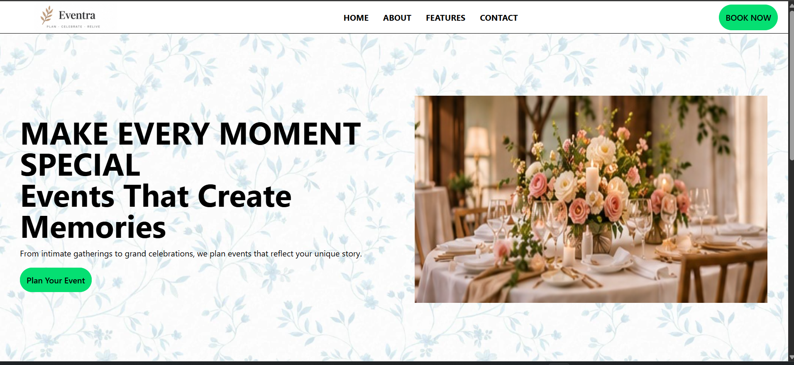
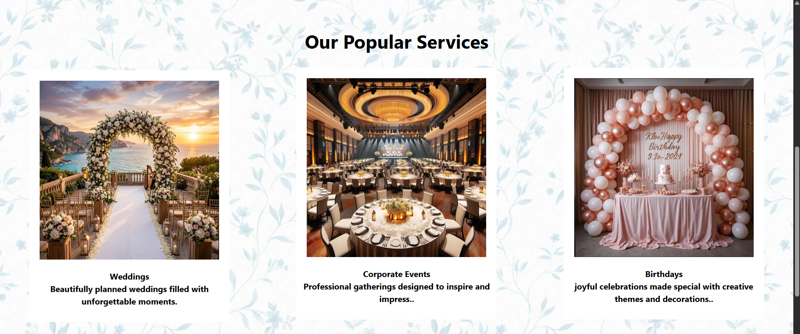
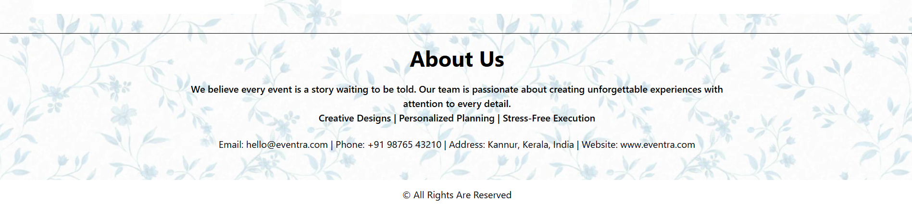

# Eventra 🎉

A responsive landing page for an event planning company, built with HTML and Tailwind CSS.


**[🔗 View Live Demo](https://eventra-orcin.vercel.app/)**

## Screenshots

### Hero Section


### Popular Services


### About Us & Footer


## About

Eventra presents an event planning company's services, brand story, and contact details in a clean single-page layout. It showcases popular services such as weddings, corporate events, and birthdays.

## Features

- Navigation bar with logo, anchor links (Home, About, Features, Contact), and a "Book Now" button
- Hero section with headline, tagline, and call-to-action
- "Our Popular Services" cards with a hover lift animation
- About Us section with company values and contact information
- Floral background theme and simple footer

## Tech Stack

- HTML5
- Tailwind CSS v4 (CDN browser build, no build step needed)
- Deployed on Vercel

## Project Structure

```
Eventra/
├── index.html
├── images/
│   ├── bg.png
│   ├── logo.png
│   ├── landing image.jpg
│   ├── wedding.png
│   ├── corporate events.png
│   └── birthdays.png
├── screenshots/
│   ├── hero.png
│   ├── services.png
│   └── about.png
└── README.md
```

## Getting Started

No installation or build process is needed.

```bash
# Clone the repository
git clone https://github.com/MuhammedRizwan2385/Eventra.git

# Go into the project folder
cd Eventra
```

Then open `index.html` in your browser, or serve it locally:

```bash
npx serve .
```

> An internet connection is required, since Tailwind CSS loads from a CDN.

## Customization

- **Brand colour:** Replace Tailwind's `green-400` classes (`bg-green-400`, `border-green-400`, `hover:text-green-400`) with another colour.
- **Services:** Duplicate or edit the card blocks in the "Popular Services" section.
- **Contact details:** Update the email, phone, address, and website in the "About Us" section.
- **Images:** Replace the files in `images/`, keeping the same names or updating the paths in `index.html`.

## Roadmap

- [ ] Mobile navigation menu (hamburger) and better small-screen responsiveness
- [ ] Booking form or contact page for the "Book Now" and "Plan Your Event" buttons
- [ ] Dedicated Features section

## License

This project is licensed under the [MIT License](LICENSE). Add a `LICENSE` file to your repository, or change this line to your preferred license.

## Author

**Muhammed Rizwan**
GitHub: [@MuhammedRizwan2385](https://github.com/MuhammedRizwan2385)
